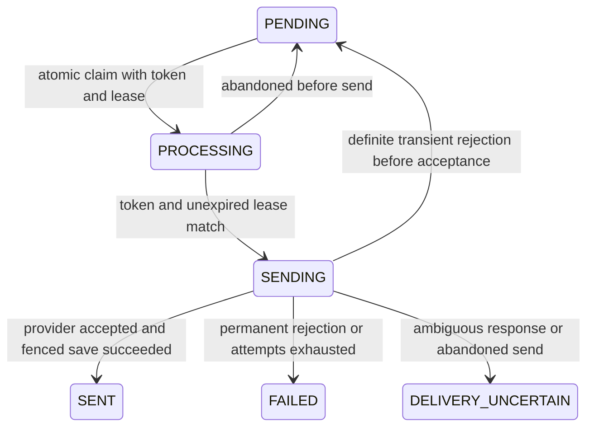

# Historical email implementation and retirement evidence

**Superseded on 2026-10-29 by the approved [unified merchant-only implementation](unified-merchant-email-system.md).** The v24 evidence below remains historical. Current code restores seven business events for new operations and routes authentication through merchant providers with no platform fallback. v1-v24 migrations remain immutable; v25 is additive. Both delivery flags remain false. No deployment or real email is authorized by implementation approval.

## Current product policy - v24 local candidate

The seven automatic business email integrations are retired: PAY_NOW_CONFIRMED, RESERVE_NOW_RESERVED, DEPOSIT_RECEIVED, GROUP_PURCHASE_SUCCESSFUL, BOOKING_CANCELLED, BOOKING_RESCHEDULED and REFUND_COMPLETED. Existing in-app notifications remain authoritative. Frontends keep using the existing business APIs; they must not call email test endpoints for customer notifications or claim inbox delivery.

OTP/password-reset requests and reset-success confirmations continue to use PLATFORM SMTP independently of merchant configuration and the retired outbox. Merchant configuration and explicit owner diagnostic tools remain available. Those manual test endpoints can send real email when explicitly invoked; they are not customer-operation integrations and were not executed against a live provider during implementation.

Customer service imports/calls for automatic enqueueing are removed. Retained event/enqueue helpers return null without storage access. Node startup no longer schedules the email job, the Worker cron no longer calls the email batch, and retained processor/recovery functions return the fixed EMAIL_BUSINESS_EMAILS_RETIRED reason without database or provider access. EMAIL_OUTBOX_ENABLED=true cannot reactivate them. Both checked-in environment flags remain false; no live settings, secrets or databases were changed.

Owner list/detail/history/skip APIs remain protected by BRAND_OWNER and single-brand access. Pending audit rows show disposition RETIRED and reason EMAIL_BUSINESS_EMAILS_RETIRED; terminal rows remain NOT_PENDING. Existing data-array pagination compatibility and sensitive-field redaction are retained. Inspection does not send or automatically alter jobs.

## v24 archival migration

New files: cloudflare/migrations/0024_retire_business_email_events.sql and prisma/migrations/20261028120000_retire_business_email_events/migration.sql. No schema/table removal or edits to v1-v23 are required. SQL targets only the seven event types:

| Existing state | v24 behavior |
| --- | --- |
| PENDING | SKIPPED; skipReason EMAIL_BUSINESS_EMAILS_RETIRED |
| PROCESSING / SENDING | Conservatively DELIVERY_UNCERTAIN; never reclaimed for resend |
| DELIVERY_UNCERTAIN / SENT / FAILED / SKIPPED | Remain unchanged, including existing metadata/history |
| Other event types | Untouched by the migration; all automatic runtime processing is nevertheless retired |

Affected jobs retain content, recipient, attempts, provider and existing timestamps where possible. Existing lastError is retained; otherwise a canonical retirement code is set. Claim tokens and leases on newly archived/quarantined rows are cleared to fence stale state writes. Each affected row receives one retirement history entry, with deterministic migration-entry ID and MAX(sequence)+1. History records preserve the prior attempt count and selected provider. Existing history is never deleted or rewritten.

SQLite atomicity is supplied by the existing applyMigrations/storage.transactionSync wrapper, including the ledger insert. PostgreSQL uses explicit BEGIN/COMMIT plus an exclusive outbox-table lock. The version ledger prevents repeated application; SQL is also idempotent on a second execution because affected rows are terminal and deterministic history IDs cannot duplicate. No provider I/O occurs during migration.

A migration cannot recall SMTP/API submissions already in flight. Before a separately approved rollout, verify delivery is off and no old sender remains active. A rolled-back pre-retirement binary could still enqueue; only retain schema-compatible retirement artifacts for rollback. Do not revert flags or drop migration history to make old binaries start.

## Retained infrastructure safety fix

safeEmailError now preserves explicit deliveryUncertain=true through TLS/SSL and all other error classifications, including the confirmed SEND-stage SSL failure. Definite pre-send TLS errors with false uncertainty remain definite. This protects retained merchant diagnostic infrastructure without reviving automatic processing.

## Local verification and future rollout

All tests use mocked providers and disposable local databases. Coverage includes customer booking/payment/wallet/reschedule/cancellation flows with zero email jobs, preserved notifications, group-purchase/refund workflows, accidental-true flag behavior, owner management, platform OTP/reset routing and v24 archival/history atomicity. Validation evidence is appended after the final checks below.

No deployment or live migration is approved by local implementation approval. A later staging rollout requires: current non-disruptive backup/recovery verification; current ledger and identity checks; delivery false and no in-flight sender; explicit deployment approval; then npm run cloudflare:deploy:staging. Pending versioned SQLite migrations initialize normally. Do not reset/seed/recreate the database or run PostgreSQL migrations against Workers. Verify frontend/API availability, owner archival/history views, in-app notifications and unchanged security-email routing afterward. No business-email activation step exists for this retired product feature.

## Final retirement verification - 2026-10-28

- Full npm run test:regression: exit 0, 220 TAP tests passed, zero failed/skipped. Includes 8 Node merchant/security/template/retirement tests, 4 mocked merchant-provider tests, 4 dedicated retirement/in-app/security-email/owner-management integration tests, and all existing financial/booking/policy regressions.
- TypeScript no-emit validation and Prisma PostgreSQL schema validation passed. No PostgreSQL migration was executed; the PostgreSQL data migration has not been exercised against a running PostgreSQL server.
- v23 -> v24 populated SQLite test passed for all seven pending event types, PROCESSING/SENDING quarantine, preservation of existing uncertain/sent/failed/skipped and unrelated rows, prior history, attempts/content, and correct MAX(sequence)+1 ordering.
- Failure injected after archival history insertion proved state, history and migration ledger roll back together. Repeated initialization and a second direct SQL execution created no duplicate history.
- All 23 previous migration checksums match the saved v23 release manifest. No applied SQL was edited. Current schema parity, foreign keys and migration checks passed.
- Historical saved-backup hash/integrity verified; disposable local restore/upgrade through v24 preserved 13,319 original cells and repeated initialization. This is rehearsal evidence, not a current live backup or live backlog audit.
- Six customer business-service files were compared against HEAD after removing only email hook imports/calls: exact match; notification calls and financial/business logic retained. The prior email-only reschedule revision increment was removed. All 148 historical route contracts passed with the two previously approved pre-existing exceptions.
- npm run cloudflare:check:staging passed, dry-run only: 7424.75 KiB upload / gzip 2044.42 KiB, flag false. Production source flag remains false. The production Worker excludes the automatic outbox processor, Node email job, test fixtures and native Node merchant SMTP.
- Current ignored evidence: cloudflare/.build/business-email-retirement-release-manifest.json; node_modules/.cloudflare-test/business-email-retirement-regression.log; business-email-retirement-staging-dry-run.log. Older v23/v22 manifests are historical.
- No live deployment, database mutation, environment/secret change or real email occurred. Live retirement protection requires a later separately approved rollout; until then the existing deployed application remains unchanged.

## Historical v23/v22 implementation notes - superseded

The material below records earlier implementation and test evidence. Its instructions for business delivery activation or automatic enqueueing no longer apply.


## Permanent outbox management upgrade (v23, local candidate)

This section supersedes the v22-only inspection/release details below. No deployment, live database migration, email activation or real send is included in this upgrade. Both Wrangler environments retain `EMAIL_OUTBOX_ENABLED=false`. The previous live backlog audit was incomplete; the current live pending jobs have not been certified safe.

### Freshness and historical records

New reservation/reschedule events capture a versioned JSON snapshot: appointment calendar date, start/end time, staff, branch and `emailScheduleRevision`. The revision increments only for a material change inside the existing reschedule transaction, including A -> B -> A changes. Event enqueueing and its initial history row remain in the existing business transaction; duplicate idempotency keys do not create duplicate events/history.

Delivery checks the snapshot before claiming and again in the short fenced transaction immediately before SENDING. It suppresses missing/changed recipients, closed/checked-in/past appointments, changed reservation state, and superseded schedules. No network call occurs inside these transactions. Legacy reservation/reschedule jobs without trustworthy structured snapshots fail closed as `SKIPPED` with `EMAIL_LEGACY_SNAPSHOT_UNVERIFIABLE`; the system never guesses identity or schedule by parsing message HTML.

`SKIPPED` is terminal, with `skipReason` and `terminalAt`; skipped rows and content remain stored. Initial freshness rejection consumes zero attempts. A job invalidated after claiming retains that consumed claim attempt and records the skip. Existing attempts count claims, not proof of network submission. Valid historical PAY_NOW, deposit, purchase, cancellation and refund notifications retain their original snapshots and are not expired merely because their appointment changed or their creation date is old. Existing recipient/brand/provider safeguards remain in force.

Delivery has a defined submission boundary: an appointment may change after validation and SENDING commit or after SMTP submission starts. An already submitted email cannot be recalled. Serialized Worker requests, schedule revisions and PostgreSQL serializable transactions protect the validation boundary; this is not a claim of exactly-once delivery or zero races after submission.

### Owner APIs

All paths below are under `/api/v1/brand-email-settings/:brandId`, require an active BRAND_OWNER token, and enforce the existing single-brand access check. API responses never contain email subject/body, encrypted credentials, OAuth data or claim tokens. Recipient addresses are masked; an exact `recipientEmail` filter supports designated-recipient audits. Do not log/share authenticated request URLs containing recipient filters.

| Method/path | Behavior |
| --- | --- |
| GET `/outbox` | Existing `data` array retained; adds `pagination` and safe metadata. Default page 1/limit 100; maximum limit 100. Stable ordering by createdAt and ID. |
| GET `/outbox/audit` | Same pagination/filters plus each page's eligibility reason, disposition and ageSeconds; reports status counts for the other selected filters. Read-only; does not claim, skip or send. |
| GET `/outbox/:jobId` | Safe detail and validation reason. A non-pending row's validation result does not authorize replay. |
| GET `/outbox/:jobId/history` | Paginated recorded transitions, attempt number, canonical code, provider, actor ID where applicable, and timestamps. |
| POST `/outbox/:jobId/skip` | Body `{"reason":"OWNER_REQUEST"}` (also OUTDATED/TEST_ONLY). Conditional PENDING-only suppression with no active lease, audited in the same transaction. Races/non-pending/uncertain jobs return 409. |

List/audit filters: `page`, `limit`, `status`, `eventType`, `provider`, exact `recipientEmail`, `createdFrom`, `createdTo`. Dates use ISO UTC timestamps. Allowed statuses: PENDING, PROCESSING, SENDING, SENT, FAILED, DELIVERY_UNCERTAIN, SKIPPED. History supports page/limit only. Invalid/unknown queries return 400; foreign-brand access 403; unknown job 404. No force-send, generic retry, or uncertain-job reset API exists.

Example read-only backlog requests:

```text
GET /outbox/audit?status=PENDING&page=1&limit=100
GET /outbox/audit?status=PENDING&recipientEmail=khanrokon571%40gmail.com&page=1&limit=100
GET /outbox?status=DELIVERY_UNCERTAIN&page=1&limit=100
```

Traverse every page. Compare total pending count against the exact test-recipient count and inspect event types. Eligibility is assessed for the returned page (`eligibilityScope=CURRENT_PAGE`), not silently extrapolated to all records. These are point-in-time reads, not a frozen cross-page export; recheck totals and latest rows immediately before any separately approved activation. No automatic TTL is applied to historical receipts.

### Delivery history and recovery

`EmailOutboxHistory` records enqueue, claim, send start, acceptance, failures/retries, lease recovery, uncertainty and owner skips. Conditional state changes and history commit/roll back together. A per-job unique sequence preserves transition order even when timestamps tie. Old attempts are not reconstructed; an empty legacy history is not evidence that an email was never sent. Owner skips record the acting owner and a fixed reason code without free-form sensitive prose. History is append-only through the application APIs; ordinary database administrators retain database-level authority.

Accepted-send/history persistence failure remains uncertain, not retryable. Stale SENDING records are quarantined, never automatically resent. Stale PROCESSING recovery preserves the existing retry semantics; recovery is bounded to 100 jobs per state per batch invocation. Repeated processing cannot replay SENT/SKIPPED/DELIVERY_UNCERTAIN records. Existing merchant-provider pinning and no-fallback-after-attempt behavior are retained.

### Cron isolation

Workers still use the existing minute trigger, `scheduled()` handler, singleton namespace and serialized queue; no second scheduler was added. Each existing task is attempted in order under `runCronTasks`; one failure cannot prevent later tasks, including email. After all tasks are attempted, any failure is reported so cron monitoring does not claim success. Worker email batch limit stays two, Node limit stays ten, and both honor the exact true flag. Processing jobs can still add provider latency to the shared Worker queue after separately approved activation.

### Migration and deployment procedure

SQLite v23: `cloudflare/migrations/0023_email_outbox_management.sql`.
PostgreSQL: `prisma/migrations/20261028100000_email_outbox_management/migration.sql`.
Both add appointment revision, nullable outbox validation/skip/terminal metadata, and the indexed history table with a restrictive outbox foreign key. No existing records are deleted or rewritten, and v1-v22 checksums remain immutable. Runtime delivery evaluation handles legacy snapshots; the migration itself sends/skips nothing. There is no new status enum migration because outbox status is already text.

Exact staging sequence, only after separate deployment approval:

1. Keep the frontend staging API online; do not deploy the maintenance Worker. Verify staging account, active version, SALON_DB namespace/class and salon-v1 identity using a non-disruptive approved read path.
2. Obtain a current usable backup/recovery point and rehearse recovery locally. The saved historical v19 backup is migration rehearsal evidence only, not a current backlog audit or current recovery point.
3. Verify the live migration ledger/checksums against this candidate. Apply only pending versioned SQLite migrations through normal Durable Object initialization. Do not run PostgreSQL migrate commands against Workers, reset/seed the database, or recreate the namespace.
4. Confirm production and staging Wrangler flags are false and preserve existing secret values. Keep a schema-compatible v23 rollback artifact with delivery off; older v22/v19 bundles reject the newer ledger.
5. Run `npm run test:regression`, `npm run typecheck`, `npx prisma validate --config prisma.config.ts`, and `npm run cloudflare:check:staging`.
6. After explicit deployment approval, run `npm run cloudflare:deploy:staging`. This uploads only staging and initializes any pending migrations on first Durable Object invocation; it does not approve email activation.
7. Verify `/`, public catalog endpoints, existing frontend authentication/CORS, owner APIs and unauthorized/cross-brand denials. Read the complete paginated backlog audit with delivery still false. Preserve SENT/uncertain rows and review all recipients/event types. Classify legacy booking messages as unverifiable; any manual skips require an explicit owner action.
8. Report the current backlog and safe classifications. Keep delivery disabled until separate backlog/activation approval. Real provider tests remain separately approved, recipient-restricted, at most once per available provider without retry approval, with independent inbox confirmation.

Local automated tests use mocked Gmail/provider I/O and disposable SQLite, including actual scheduled-handler dispatch, unrelated cron failure, stale events, A-B-A changes, owner API access/filtering/redaction, history atomicity, retries/concurrency and uncertain-send protection. Live Gmail reachability, inbox receipt and current live backlog remain external release gates.


### Final v23 local verification - 2026-10-28

- `npm run test:regression`: exit 0; **224 TAP tests passed, zero failed/skipped**. Includes 7 Node merchant/security/template/eligibility tests, 4 mocked provider integration tests, 9 transactional outbox tests, and existing business regressions. All 148 historical route contracts retained with the two previously approved exceptions.
- `npm run typecheck` and `npx prisma validate --config prisma.config.ts`: passed. No live PostgreSQL upgrade was run.
- SQLite migration upgrade through v23, repeated initialization, foreign keys/checksum guards and fresh schema parity: passed.
- Saved historical staging backup: hash verified, local SQLite integrity passed; disposable restore/upgrade through v23 preserved 13,319 existing cells and repeated initialization. This is not a current live-backlog audit.
- `npm run cloudflare:check:staging`: passed, dry-run only. Artifact 7440.72 KiB / gzip 2049.03 KiB; EMAIL_OUTBOX_ENABLED false. Production bundle excludes test fixtures and native Node merchant SMTP.
- Postman collection: valid JSON, 20 requests. Full-collection execution remains inappropriate because it includes real-send/configuration/skip actions.
- Current build evidence: ignored `cloudflare/.build/outbox-v23-release-manifest.json`; local logs `node_modules/.cloudflare-test/outbox-final-regression.log` and `outbox-staging-dry-run.log`. The earlier v22 release manifest/evidence below is historical.
- No live database, deployment, secret update or real email operation occurred. Current staging backlog eligibility and inbox/provider sign-off remain unverified. Both production/staging delivery flags remain false.

## Audit: authoritative event sources

This mapping was recorded before integrating business email. Existing notifications and financial calculations remain authoritative; email hooks only insert records in the same transaction. No transport runs in those transactions.

| Event | Authoritative source and state | Identity |
| --- | --- | --- |
| PAY_NOW confirmed | `payment.service.ts` normal active-hold Stripe settlement; `wallet.service.ts` guarded wallet appointment settlement. CONFIRMED/PAID only, excluding group-purchase appointments | appointment ID |
| RESERVE_NOW reserved | `appointment.service.ts` reservation creation; `group-purchase.service.ts` direct-book RESERVE_NOW appointment creation. RESERVED only | appointment ID |
| Deposit received | `payment.service.ts` normal active-hold appointment deposit settlement, RESERVED/PARTIALLY_PAID; group deposits use the group-purchase event instead | appointment ID |
| Group purchase successful | `payment.service.ts` initial Stripe settlement and `wallet.service.ts` initial wallet settlement. Paid or deposit-partially-paid purchase with settled payment; unpaid direct-book RESERVE_NOW becomes successful at its first paid salon settlement in `group-purchase.service.ts` | purchase ID |
| Booking cancelled | Legacy `appointment.service.ts` cancellation and policy `cancellation-refund.service.ts` guarded cancellation | appointment ID |
| Booking rescheduled | `appointment.service.ts` successful update inside reschedule transaction; no-op date/time/staff repeats are excluded | new operation UUID persisted in outbox; prior/new schedule in snapshot |
| Refund completed | `payment.service.ts` late appointment/group Stripe finalization and direct wallet refund; `refund-request.processing.ts` approved Stripe/wallet completion | actual successful Refund ID |

QR verification, voucher redemption, remaining payment after an already successful purchase, completion, top-up, failed payments/refunds and reminders do not create email events. Existing platform OTP/password reset remains separate.

## Release boundary

Implementation and mock verification are local. This task prepares deployment artifacts; it does not authorize a production deployment, business-email scheduler activation, or real customer email. Live merchant tests and inbox confirmation remain separate. `EMAIL_OUTBOX_ENABLED` must stay absent/false until separately approved.

The live frontend staging API must remain online. Do not deploy the maintenance Worker to complete email development or testing. The restored live version/database and HTTP evidence are documented in [staging-api-restoration-report.md](staging-api-restoration-report.md). All implementation checks below use disposable local databases and mocked delivery.

## Transaction and delivery architecture

All seven events resolve the customer through the business record and insert the existing EmailOutbox row inside the existing Prisma transaction. A rollback removes both changes. Only the processor performs network delivery, after commit. Missing/invalid recipient or an ambiguous single-brand context skips enqueueing without failing the booking. Storage failures still obey the existing atomic transaction; they are not silently converted into a committed business change with a lost email event.

Keys are `<brandId>:<eventType>:<businessRecordId>`. Reschedules add a persisted operation UUID: the same target date/time/staff is a no-op for email; each genuinely committed subsequent schedule change has a distinct key. Serializable business transactions and existing guarded updates remain in place. There is no exactly-once network-delivery claim.



Claiming uses an atomic conditional update on ID, PENDING state, attempt count, due time and lock expiry. A random claim token fences every subsequent state write; stale workers cannot complete or release another worker's job. The lease is five minutes. Recovery distinguishes PROCESSING (no send started) from SENDING (possibly submitted): only the former is reclaimed automatically. A crash after SENDING is recorded but before actual I/O may therefore conservatively require manual inspection.

Up to three attempts are allowed, with 2/4-minute backoff for the first two failures (delay capped at 60 minutes). SMTP 4xx rejections and definite connection/TLS failures can retry. SMTP 5xx recipient rejection, authorization/configuration failures and HTTP client rejection are permanent. Submission timeout, ambiguous provider response, or accepted-send persistence failure is DELIVERY_UNCERTAIN, never an automatic retry. If even the uncertainty write fails, the stale SENDING lease is later quarantined. The processor records provider, message ID where supplied, attemptedAt, sentAt, attempts and canonical error code. SENT means provider acceptance, **not inbox delivery**.

Initial provider selection uses current enabled/verified/runtime-ready merchant settings, otherwise platform SMTP. A merchant attempt never falls back to platform after failure, including later queued retries: once an attempt records a provider, a subsequent change to another provider/platform fails with EMAIL_RETRY_PROVIDER_CHANGED for operator review. Unattempted queued jobs resolve current provider settings at processing time. The resolver rechecks the repository's exactly-one-brand invariant; an unknown brand cannot silently use platform SMTP. OTP/password-reset imports and transport remain platform-only.

## Templates and recipient isolation

`brand-email-setting.templates.ts` produces responsive HTML tables plus plain text for en, zh-CN and zh-HK. It uses existing preferredLanguage/default-language conventions and localized item snapshots, escapes dynamic HTML, formats currency through Intl, and labels stored appointment calendar dates/times as Asia/Hong_Kong. SMTP/Resend receive both alternatives. Microsoft Graph receives base64 MIME with both parts when both exist, using the documented [Graph sendMail MIME contract](https://learn.microsoft.com/en-us/graph/api/user-sendmail?view=graph-rest-1.0).

Deposit receipts use the actual successful deposit Payment amount and stored appointment remainingAmount. Group receipts use the settled Payment (or first successful salon Payment for an initially unpaid Reserve Now purchase), stored total/remaining amount, quantity and supported package validity. No voucher code or redemption promise is invented. Refund receipts use the distinct SUCCEEDED Refund record and verify that payment, appointment/purchase and customer relationships agree. QR tokens, provider credentials, raw payment data and message bodies are excluded from operational logs and the inspection API.

## Scheduler and operations

Workers reuse the existing minute cron and Durable Object request queue; no second Cloudflare scheduler was created. The outbox batch is capped at two jobs per Worker tick and errors are isolated from existing maintenance jobs. Node uses `email-outbox.job.ts`, prevents overlapping local ticks, and caps a batch at ten; database fences coordinate multiple Node processes.

Both processing entry points require the exact string `EMAIL_OUTBOX_ENABLED=true`. It defaults to false in `.env.example` and both Wrangler environments. Event enqueueing remains durable while delivery is off. **Review the accumulated backlog before separately approving activation.** No live flag or cron schedule was changed during implementation.

Owner-only `GET /api/v1/brand-email-settings/:brandId/outbox` returns the latest 100 jobs' metadata, including pending/failed/uncertain states. It excludes recipient, subject/body, OAuth/encrypted credentials and claim tokens; legacy error prose is replaced by a canonical legacy-failure marker. The endpoint cannot retry or send a job. The Postman collection includes this read-only request; do not run the complete collection as a delivery runner.

Monitor FAILED, DELIVERY_UNCERTAIN, old PENDING jobs, expired leases, attempt counts and safe EMAIL_JOB_STORAGE_FAILED/EMAIL_BATCH_STORAGE_FAILED codes. Investigate uncertain jobs with provider logs and the designated user's inbox before deciding whether any resend is appropriate. There is deliberately no automatic uncertain-job replay or retry endpoint. Message content is stored in the outbox for asynchronous delivery; apply database access controls and an owner-approved retention policy. This task does not delete historical rows automatically.

## Schema and file map

v19/v20/v21 remain immutable. New additive SQLite `0022_email_outbox_delivery_fence.sql` and PostgreSQL `20261028090000_email_outbox_delivery_fence/migration.sql` add nullable claimToken, attemptedAt and text. Old PROCESSING jobs and previously attempted PENDING jobs are quarantined as DELIVERY_UNCERTAIN once, without changing unattempted PENDING or historical SENT records. Existing credentials/bookings/payments/refunds remain intact. v21's verification reset is still one-time.

Files added or extended for this transactional task (paths relative to repository root):

- `src/app/module/brand-email-setting/brand-email-setting.events.ts`, `.templates.ts`, `.outbox.ts`, `.outbox-processor.ts`, `.sender.ts`, `.route.ts`, `.errors.ts`, `.http.ts`, `.microsoft.ts`, `.test.ts` (each abbreviated suffix uses the `brand-email-setting` prefix).
- `src/app/module/appointment/appointment.service.ts`, `src/app/module/cancellation-refund/cancellation-refund.service.ts`, `src/app/module/group-purchase/group-purchase.service.ts`, `src/app/module/payment/payment.service.ts`, `src/app/module/refund-request/refund-request.processing.ts`, `src/app/module/wallet/wallet.service.ts`: transaction-local hooks only; financial calculations, eligibility, state transitions and existing notification payloads remain authoritative.
- `src/app/jobs/email-outbox.job.ts`, `src/server.ts`, `cloudflare/worker.mjs`, `wrangler.jsonc`, `.env.example`: disabled-by-default scheduler integration.
- `prisma/schema/brandEmailSetting.prisma`, both v22 migration paths above, generated `cloudflare/prisma/schema.prisma` and `cloudflare/runtime/model-metadata.json`; `scripts/build-cloudflare.mjs`, `scripts/check-cloudflare-schema.mjs`, `scripts/test-cloudflare-migrations.mjs`: schema/build parity.
- `cloudflare/business-email.integration.test.mjs`, `cloudflare/runtime/business-email-fixture.mjs`, `cloudflare/runtime/email-test-fixture.mjs`, `cloudflare/runtime/integration-fixture.mjs`, `cloudflare/test-support/public-worker.mjs`, `cloudflare/book-now.integration.test.mjs`, `cloudflare/merchant-policy.integration.test.mjs`, `cloudflare/email-provider.integration.test.mjs`, `cloudflare/runtime/database-fixture.mjs`, `cloudflare/runtime/migration-fixture.mjs`, `cloudflare/runtime/smtp.mjs`, `package.json`: transport, migration, security and event evidence.
- `docs/merchant-email.postman_collection.json`, `docs/merchant-email-provider-guide.md`, this guide and `cloudflare/README.md`: manual workflow and release evidence. The complete earlier provider implementation map remains in the provider guide.
- `scripts/inventory-routes.mjs`: two user-approved pre-existing contract changes are checked explicitly while the historical baseline remains immutable: staff detail retains OWNER/MANAGER/STAFF/CUSTOMER access, and the manual appointment-complete route remains absent in favor of the existing completion job. No staff/appointment route implementation was changed for these decisions. Every other historical middleware/controller contract remains strict.

## Environment and deployment checks

New delivery activation setting: `EMAIL_OUTBOX_ENABLED=false`. Provider prerequisites remain `EMAIL_ENCRYPTION_KEY` (existing persistent 64-hex-character key), platform SMTP_HOST/PORT/USER/PASSWORD/EMAIL_SENDER, and optional Microsoft client ID/client secret/tenant/redirect URI for Microsoft use. Resend needs domain-management permission and a verified exact sender domain. QQ/163 need provider authorization codes. Arbitrary custom SMTP remains Node-only. No new secret is required merely to build this inactive feature.

Staging release checklist, to be executed only after separate deployment approval:

1. Keep the currently working staging API online. Do not deploy maintenance as part of email development. Confirm the active version and existing namespace/singleton; never rename/recreate them.
2. Verify a current usable backup/PITR recovery point through an approved non-disruptive process. The saved v19 backup is a tested rehearsal input, not a claim that it includes changes made later by frontend developers.
3. Recheck the live ledger against the candidate's immutable history. v20/v21/v22 are pending only when the live database is still v19. Never run PostgreSQL migrations against the Worker database.
4. Keep EMAIL_OUTBOX_ENABLED false; retain existing secret values and review cron configuration. A normal Wrangler deploy would reinstate the pre-existing minute cron from configuration; that is separate from activating email delivery.
5. Run the existing staging check/dry-run, then deploy the prepared application with `npm run cloudflare:deploy:staging` only after approval. Its Durable Object initializes pending versioned migrations; do not separately reset or seed the database.
6. Probe `/` health, public catalog endpoints, valid frontend auth and credentialed CORS. `/api/v1` itself has no health handler and returns 404; authenticated lists can return 401 without a token.
7. Read merchant configuration/outbox metadata with valid owner access. Old merchant configuration stays disabled/unverified after v21 until an explicit retest/enable. No automatic enable occurs.
8. The user can manually test only the approved direct `/test-email` endpoint. Recipient: khanrokon571@gmail.com; sequential maximum one attempt per available provider, no automatic retry. Missing consent/credentials/domain readiness stays pending. Confirm inbox separately.
9. Keep live business delivery disabled until safe mock staging fixtures, provider sign-off, backlog review and explicit activation approval are complete. Do not create production bookings/charges or send real customer emails as a smoke test.

Production checklist: all relevant automated checks and documented regression issues resolved; staging behavior and real provider/inbox sign-off recorded; correct production secrets and OAuth/domain setup; current backup and rehearsed recovery; compatible application artifact retained; explicit production-deployment approval; separate scheduler/backlog activation approval and monitoring ownership. Production has not been deployed by this task.

For a separately approved Node/PostgreSQL rollout, validate the correct direct migration connection and backup first, then apply versioned migrations with `npx prisma migrate deploy --config prisma.config.ts` before starting the new server. This command is documentation only; no PostgreSQL migration was executed during this task. Prisma schema validation and the real SQLite migration/upgrade tests do not certify a live PostgreSQL upgrade.

## Rollback and recovery

Do not reset the database or edit `_Migrations`. Once v22 is applied, the restored historical v19 application version is **not** a valid automatic rollback: its migration checker rejects extra versions. Keep an application artifact that understands the v22 ledger/schema with EMAIL_OUTBOX_ENABLED=false, or forward-fix using a schema-compatible version. Disable outbox processing before investigating a delivery incident; do not clear SENDING/DELIVERY_UNCERTAIN records for replay. Database/PITR restoration is a separately approved recovery operation because it can discard newer frontend/customer writes. Preserve encrypted credentials and the matching encryption key.

## External verification and status

The frontend's staging API remains the restored v19 application. This candidate is local; real delivery, the new candidate's staging deployment and production activation are distinct uncompleted release gates. Microsoft tenant setup and Resend DNS readiness cannot be certified by mocks. No real test email was sent during this implementation. Final automated evidence follows.

The Worker currently serializes cron processing and HTTP requests through its existing Durable Object queue. Once separately enabled, a two-message email batch can add bounded SMTP/API wait time to queued requests; verify that latency under staging load before live activation. With EMAIL_OUTBOX_ENABLED=false, there is no business-email network wait in cron. The live restored staging worker's cron triggers remain paused; completion-job implementation is preserved, not newly activated.

## Final validation — 2026-10-28

`npm run test:regression` completed with exit code 0: **220 TAP tests passed, zero failed/skipped**, plus database adapter, migration, schema-drift and route-inventory assertions. An earlier run exposed the old route baseline mismatches; the two exact user-approved contract decisions above resolved those checks without changing application routes or rewriting the historical baseline.

| Check | Result |
| --- | --- |
| TypeScript typecheck and Node production compilation | Passed |
| PostgreSQL Prisma schema validation | Passed; no live PostgreSQL migration executed |
| Error handling / auth / SMTP / database retry | 38 / 8 / 5 / 4 TAP tests passed |
| Booking / in-app notifications / refund safety / financial proof | 24 / 8 / 22 / 12 TAP tests passed |
| Merchant provider Node/security/template tests | 6 passed |
| Mocked Worker merchant/OAuth/domain integration | 4 passed; includes full provider workflows |
| Transactional Worker outbox/event/localization integration | 6 passed; includes many workflow assertions within each test |
| Existing Worker API / remaining payment | 6 passed |
| Book Now / policy calculation / policy API | 19 / 34 / 24 passed |
| Fresh SQLite schema drift and upgrade through v22 | Passed |
| Captured v19 staging backup local restore and v22 upgrade | Passed; 13,319 existing cells preserved; repeated initialization passed |
| Historical route contracts | 148 checked; exactly one approved role update and one approved retirement; no method/path collisions |
| `npm run cloudflare:check` | Passed; dry-run only |
| `npm run cloudflare:check:staging` | Passed; dry-run only |
| Final Worker dry-run upload size | 7421.85 KiB; gzip 2043.58 KiB |
| Production bundle isolation | Test fixtures and native Node merchant SMTP excluded; event/templates/fenced processor included |
| Postman collection | Valid JSON; 16 manual requests, including read-only outbox inspection |
| Whitespace/diff check | Passed |

The policy tests now check actual existing safeguards: deposits refund only their successful original funding record before check-in; checked-in cancellation is blocked; ordinary wallet checkout rejects a DEPOSIT hold without changing financial records. No eligibility/refund/wallet calculation was changed to obtain a passing test.

Additional coverage includes duplicate signed webhooks, a repeated reschedule target, legitimate later reschedules, rollback removing an email event, failed/pending refunds producing no receipt, cross-customer refund rejection, invalid recipients, unknown brands, unapproved event rejection, atomic concurrent claims, exhausted retry budget, transient/permanent SMTP rejection, abandoned pre-send/send leases, stale sender fencing, accepted-send persistence failure, provider changes before first attempt, and **no platform fallback on a later retry of an already attempted merchant job**. All external email and Stripe operations are mocked in these tests.

Build evidence is stored in ignored `cloudflare/.build/email-release-manifest.json`: current artifact hashes, 22 migration checksums, false delivery flags, test counts and bundle-isolation assertions. Detailed local logs are under `node_modules/.cloudflare-test/transactional-email-final-verified.log`, `email-release-production-dry-run.log` and `email-release-staging-dry-run.log`. No secret values are exported in the manifest or this documentation.

Read-only live availability verification at `2026-10-28T07:48:00.912Z`: application version `7d7feaa2-f1bb-4be5-99d4-3b585e40bd14` retained 100% staging traffic; `/`, `/api/v1/branches` and `/api/v1/services` returned 200; cron count remained 0. No staging mutation was performed while completing this implementation. Review-module edits present in the shared workspace were preserved; this task adds no review email event.

| Readiness status | Current outcome |
| --- | --- |
| Implementation complete | Yes, for the seven approved business events and reused provider/outbox architecture |
| Automated verification | Passed, including full regression and both dry-runs |
| Candidate ready for separately approved staging rollout with delivery disabled | Yes, subject to current release-time backup/configuration checks |
| Existing frontend staging API available | Yes; restored application kept online |
| New email candidate staging verified | Pending deployment and owner/API/provider sign-off |
| Live transactional delivery / scheduler activated | No |
| Production email activation sign-off | Pending real provider/inbox verification and operational release gates |
| Production deployed | No |
